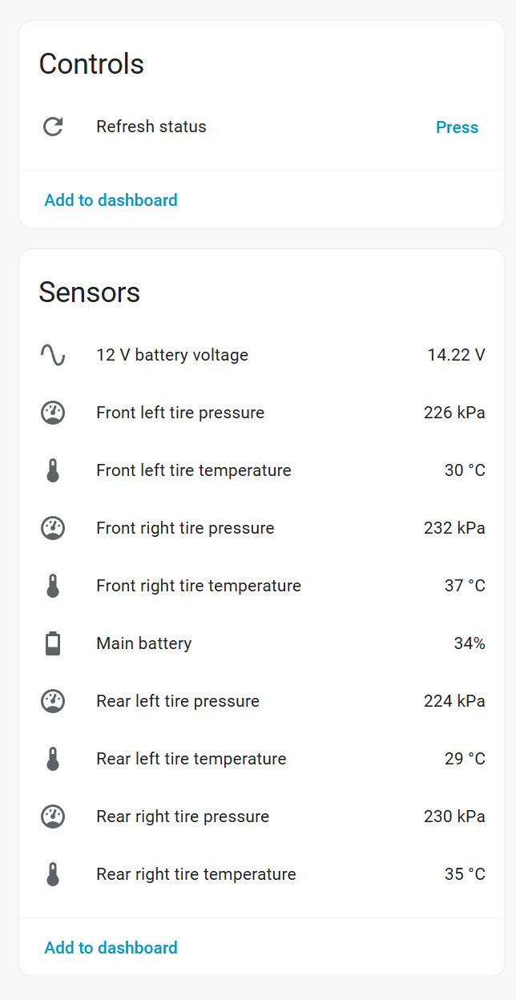

# Chery iCar BLE for Home Assistant

Monitor your Chery iCar's battery and tires locally over Bluetooth, using an
ESPHome Bluetooth proxy or a Bluetooth adapter connected to Home Assistant.

**No cloud account or app credentials required for the tested status connection.**



## What you get

- Main battery charge percentage.
- 12 V battery voltage.
- Tire pressure and temperature for each wheel.
- A **Refresh status** button for an immediate reading.
- Automatic discovery of nearby cars whose Bluetooth name starts with `CHR`.
- Polling every **30 minutes** by default, with a configurable interval.

The integration reads status only. It does not unlock, start, or otherwise control
the car. Each poll disconnects after reading, leaving Bluetooth available between
updates.

## Before you start

You need:

- Home Assistant **2026.10 or newer**.
- A compatible Chery iCar using the CarLinko Bluetooth protocol.
- An **ESPHome Bluetooth proxy near the car**, added to Home Assistant with active
  connections enabled, or a supported local Bluetooth adapter within range.
- [HACS](https://hacs.xyz/) for the recommended installation method.

Status readings have been confirmed on the owner's vehicle through Home Assistant
and an ESPHome proxy. Other Chery models and firmware versions are not yet verified.
The automatic setup flow has local regression tests; broader live testing is welcome.

## Install with HACS

This repository is available as a **custom repository**, not in HACS's default catalog.

1. Open **HACS** in Home Assistant.
2. Open the three-dot menu and choose **Custom repositories**.
3. Enter `https://github.com/hmsta/ha-chery-icar` and select **Integration** as the type.
4. Add the repository, find **Chery iCar BLE**, and download it.
5. **Restart Home Assistant.**
6. Go to **Settings > Devices & services > Add integration**, then search for
   **Chery iCar BLE**.

If you installed an earlier version manually, HACS can manage the same integration
folder. Keep your existing vehicle configuration; you do not need to add it again.

### Add your car

- **One car found:** confirm its name and choose your polling interval.
- **Several cars found:** select yours from the list.
- **No car found:** check the proxy and phone connection, then choose **Search again**.
  Manual Bluetooth address entry is available as a fallback.

The integration checks the connection and reads status before completing setup.
If that fails, your selection is kept so you can retry.

### Manual installation

Download this repository and copy the `custom_components/chery_icar` folder into
Home Assistant's `/config/custom_components/` directory. Restart Home Assistant,
then add **Chery iCar BLE** as described above.

## Using it

Open the vehicle under **Settings > Devices & services > Chery iCar BLE** to see
its sensors and **Refresh status** button. Use **Add to dashboard** to display them.

Use the integration's **Configure** menu to change polling from the default
30 minutes to any interval from 1 to 1440 minutes. Changing the interval reloads
the integration and requests a reading immediately.

Tire pressure is reported in kPa. Home Assistant's sensor settings let you choose
bar or psi. Temperature is reported in Celsius and supports HA's unit conversion.

## Keep using CarLinko on your phone

The tested car appears to allow only one active BLE client at a time. If CarLinko
holds the connection, Home Assistant may be unable to find or connect to the car.

On the owner's Samsung phone, setting **Settings > Apps > CarLinko > Battery >
Restricted** allowed HA to reconnect after leaving the app. In German, this is
**Einstellungen > Apps > CarLinko > Akku > Eingeschraenkt**.

You can leave phone Bluetooth enabled for other devices and still open CarLinko
when needed. Close or leave CarLinko afterward and allow time for Android to
release its connection. Behavior may vary by phone and app version; background
restriction does not guarantee an immediate disconnect.

## Troubleshooting

| Problem | What to check |
| --- | --- |
| No car found | Move the proxy closer, check it is online, and close CarLinko on your phone. Then search again. |
| No active adapter or proxy | Add the ESPHome device to HA and enable active Bluetooth connections. |
| Connection fails | Another app may hold the connection, the car may be asleep, or Bluetooth range may be insufficient. Retry after checking these. |
| Sensors become unavailable | The last poll failed. Try **Refresh status** when the car is nearby and CarLinko has released its connection. |
| Setup fails after updating files | Restart Home Assistant so it reloads the integration and its manifest. |

For an existing ESPHome proxy configuration, active connections can be enabled with:

```yaml
bluetooth_proxy:
  active: true
```

This is a configuration fragment, not complete ESPHome firmware. See the
[ESPHome Bluetooth proxy documentation](https://esphome.io/components/bluetooth_proxy/).

## Compatibility and limitations

- Tire scaling and wheel positions were verified against the owner's CarLinko display.
  They may differ on other vehicles.
- The vehicle may return cached readings. Polling successfully does not prove
  when each sensor last measured its value.
- Sleep behavior and the effect of frequent polling on the car are not yet characterized.
- Tire invalid-value indicators have not been fully decoded.
- Mileage, range, location and vehicle-control features are not exposed.

For problems, [open an issue](https://github.com/hmsta/ha-chery-icar/issues) with your
HA version, vehicle model, and relevant error message. Remove private data from
logs before sharing them.

## Development

Python 3.12+ can run the local tests:

```sh
python -m pip install -r requirements-test.txt
python -m unittest discover -s tests -v
ruff check custom_components tests
```

Tests cover packet parsing, simulated BLE connections, discovery and configuration
flow contracts. The HA framework is simulated in those tests; they do not replace
live integration testing. Runtime Bluetooth dependencies are supplied by Home
Assistant rather than pinned to a competing version.

Local APKs, captures, logs, tools and build files stay in `artifacts/`, which is
excluded from Git. Public tests use synthetic status packets.
